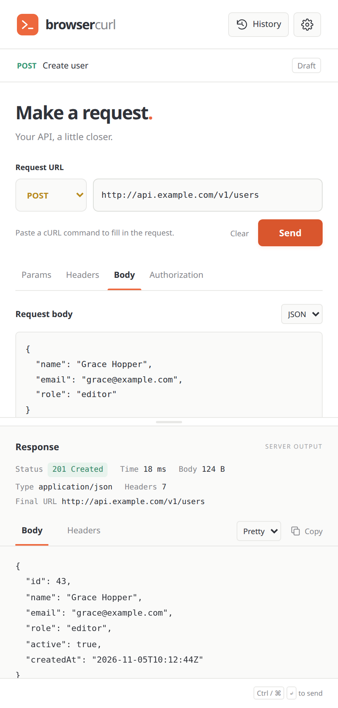
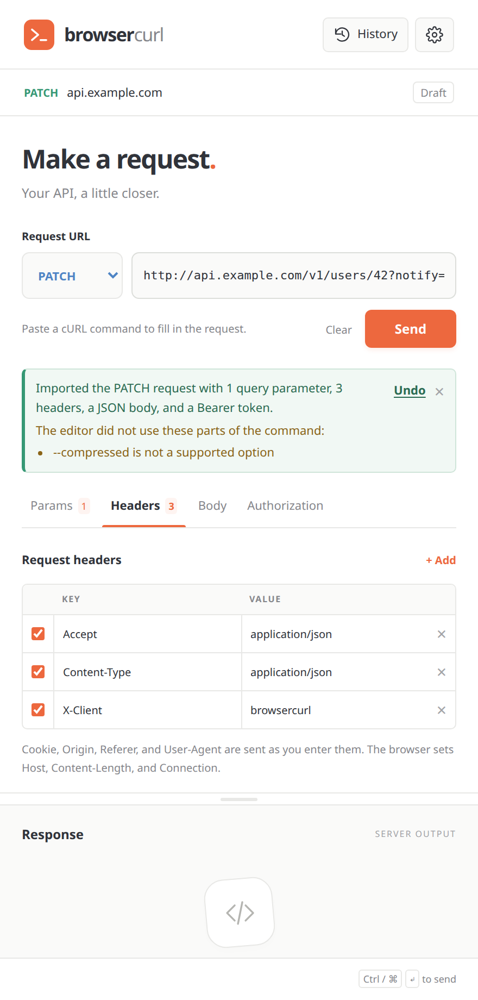
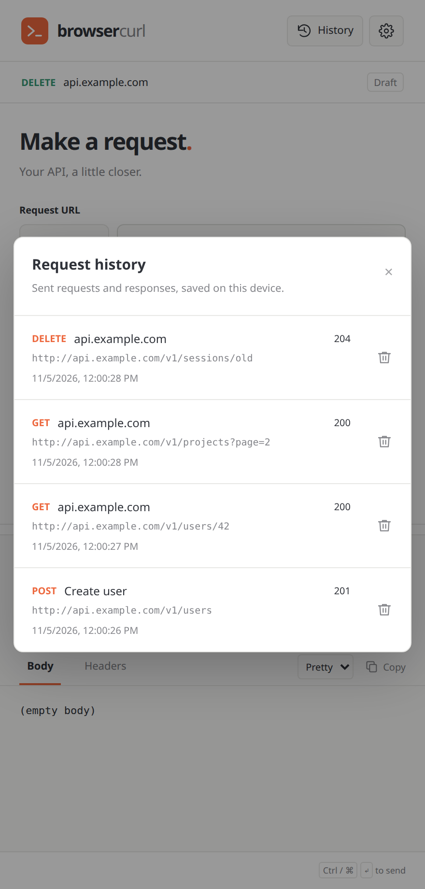
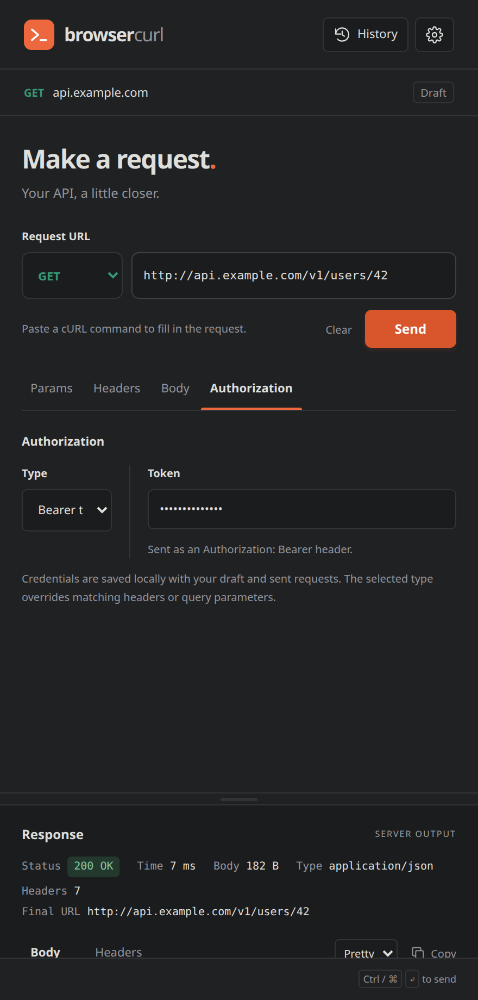

# browsercurl

A REST API client in the browser sidebar for Chromium and Firefox. Send HTTP requests, import cURL commands, and inspect responses without leaving your browser.

[Get browsercurl for Firefox](https://addons.mozilla.org/en-US/firefox/addon/browsercurl/)

## Screenshots

<table>
  <tr>
    <td align="center"><br><sub>Send a JSON request and inspect the response</sub></td>
    <td align="center"><br><sub>Import a cURL command into the editor</sub></td>
  </tr>
  <tr>
    <td align="center"><br><sub>Reopen sent requests from history</sub></td>
    <td align="center"><br><sub>Use dark mode and authorization</sub></td>
  </tr>
</table>

## Features

- **Request editor:** Set the HTTP method, URL, query parameters, headers, and JSON or text body. Keep disabled rows for later use.
- **Authorization:** Use Bearer tokens, Basic auth, API keys in headers or query parameters, or a custom Authorization header.
- **cURL import:** Paste a command into the URL field to fill the editor. Review import warnings and select **Undo** to restore the earlier values.
- **Background requests:** Keep requests running after the panel closes. Reopen the panel to view the result or cancel a running request.
- **Collections:** Save and reopen named requests in collections and nested folders. Import Postman Collection v2.0 or v2.1 JSON files and export v2.1 files, including supported authorization and disabled rows. Export asks you to confirm that the file contains saved credentials. Import warnings list dropped scripts, descriptions, saved examples, protocol settings, and unsupported body or auth types. Collection and folder authorization is copied into requests. Other unrecognized fields are dropped. Define base variable names with a collection’s **Environments** action, create forks such as `local` and `staging` with values, and choose one in the request heading. Sending a collection request replaces `{{name}}` from the chosen fork and blocks missing values. Fork values stay on this device and are omitted from exports.
- **Drafts and history:** Restore unfinished drafts and browse the latest 100 sent requests, including their responses or failures.
- **Response viewer:** Inspect status, headers, size, and duration. Switch between raw text and formatted JSON, then copy the result.
- **Panel controls:** Resize the response area and send requests with **Ctrl+Enter** or **Command+Enter**.
- **Size settings:** Limit response downloads and choose which response bodies history saves.

## Install from Firefox Add-ons

browsercurl is available on Firefox Add-ons. Mozilla signs this version, so it installs in standard Firefox Release:

1. Open [browsercurl on Firefox Add-ons](https://addons.mozilla.org/en-US/firefox/addon/browsercurl/).
2. Select **Add to Firefox**.
3. Review the permissions and confirm the installation.
4. Select the browsercurl toolbar icon to open the sidebar.

Firefox updates the add-on automatically.

## Install release packages

Use these packages for Chrome, or for Firefox development and testing.
Download the package for your browser from [GitHub Releases](https://github.com/iambpn/browser-curl/releases).
ZIP files contain unpacked builds. Firefox `-unsigned.xpi` files have no Mozilla signature. Chrome `-self-signed.crx` files use a local signing key.

### Chrome

#### Install the ZIP

1. Extract the Chromium ZIP into a folder you can keep on your computer.
2. Open `chrome://extensions` in Chrome.
3. Turn on **Developer mode**.
4. Select **Load unpacked**.
5. Select the extracted folder that contains `manifest.json`.
6. Open Chrome's extensions menu and pin **browsercurl** for easy access.

Keep the extracted folder after installation. Select the browsercurl toolbar icon to open the sidebar.
See [Chrome's installation guide](https://developer.chrome.com/docs/extensions/get-started/tutorial/hello-world#load-unpacked) for more details.

#### Install the CRX

On Linux, Chrome permits manual installation of locally signed CRX packages:

1. Download the `-chromium-self-signed.crx` file.
2. Open `chrome://extensions` and turn on **Developer mode**.
3. Drag the CRX file onto that page.
4. Review the permissions and confirm the installation if Chrome allows it.

Standard Chrome on Windows and macOS restricts installation outside the Chrome Web Store to enterprise-managed environments.
Use the ZIP instructions above for local development on those platforms.
A self-signed CRX is not Chrome Web Store signed. See [Chrome's distribution rules](https://developer.chrome.com/docs/extensions/how-to/distribute).

### Firefox

#### Temporary installation

Standard Firefox Release blocks normal installation of unsigned XPI files. Load the unsigned XPI or ZIP temporarily for testing:

1. Open `about:debugging` in Firefox.
2. Select **This Firefox**.
3. Select **Load Temporary Add-on**.
4. Select the downloaded `-firefox-unsigned.xpi` or Firefox ZIP. You can also extract the ZIP and select its `manifest.json` file.
5. Select the browsercurl toolbar icon to open the sidebar.

Firefox removes the temporary installation when you restart the browser. Repeat these steps to load it again.
See [Firefox's temporary installation guide](https://extensionworkshop.com/documentation/develop/temporary-installation-in-firefox/) for more details.

#### Persistent installation for development

Firefox Developer Edition, Nightly, and ESR support unsigned installation when signature checks are disabled.
This approach does not work in standard Firefox Release or Beta.

For guidance, see [Installing unsigned extensions permanently to Firefox Developer edition](https://wiringbits.net/browser-extensions/2020/11/27/installing-unsigned-extensions-permanently-to-firefox.html/).
The article includes an update explaining the Firefox Release limitation.
Check [Mozilla's Firefox edition guide](https://extensionworkshop.com/documentation/develop/choosing-a-firefox-version-for-extension-development/) for supported development versions.

In a separate development profile on a supported Firefox edition:

1. Open `about:config`.
2. Set `xpinstall.signatures.required` to `false`.
3. Open `about:addons` and select **Install Add-on From File** from the gear menu.
4. Select the `-firefox-unsigned.xpi` file and confirm the installation.

Disabling signature checks affects every extension in that profile. Re-enabling checks can disable unsigned extensions.
For normal Firefox Release installation, use the [Firefox Add-ons version](https://addons.mozilla.org/en-US/firefox/addon/browsercurl/). See [Mozilla's signing guide](https://extensionworkshop.com/documentation/publish/signing-and-distribution-overview/).

## Usage

1. Select the extension toolbar icon to open the sidebar.
2. Enter a URL or paste a cURL command into the URL field.
3. Set the method, parameters, headers, body, and authorization as needed.
4. Select **Send** to make the request and inspect its response.
5. Select **History** to reopen a saved request. Select **Back to draft** to return to the earlier draft.

Select **Save as** to keep a request in a collection, then **Collections** to open it again.

Select the gear button to change response limits. Select **Clear** to empty the editor and visible response. Saved history and running requests remain available.

### Response limits

- **Maximum response size:** Defaults to 10 MB. The permitted range is 1 to 100 MB. Larger responses stop at this limit and show a cutoff notice.
- **History body limit:** Defaults to 2 MB. The permitted range is 0 to 100 MB. Enter 0 to prevent history from saving response bodies.

For bodies above the history limit, history keeps the request, status, headers, and size. The sending panel still shows the live body up to the maximum response size.
Binary bodies, such as images and PDFs, are not displayed or saved in history.

### Storage and permissions

Drafts, history, and collections stay in local extension storage, including entered credentials and saved response bodies. They are not synced to another device.
History keeps the newest 100 requests. Delete an entry to remove its request and response. Removing the extension also removes its local data.

The extension requests access to HTTP and HTTPS sites so the background script can send requests without web page CORS restrictions.
The `storage` and `unlimitedStorage` permissions support saved drafts, collections, and response history. The extension does not inject content scripts into web pages.

Chromium uses network rules to set headers such as Cookie, Origin, Referer, User-Agent, and `Sec-*`. Firefox uses a blocking `webRequest` listener.
The browser controls Host, Content-Length, and Connection. If the editor has no Origin header, the extension removes the browser's own Origin header.

## Development

### Requirements

- Node.js 22.12 or later, as required by the installed Extension.js version.
- pnpm 12.4.1, as specified in `package.json`.
- The browser you want to use for local development.

### Setup

Install the project package manager if needed:

```bash
npm install --global pnpm@12.4.1
```

Clone the repository and install the locked dependencies:

```bash
git clone https://github.com/iambpn/browser-curl.git
cd browser-curl
pnpm install --frozen-lockfile
```

### Run locally

Start development mode with automatic reloads:

```bash
pnpm dev
```

The default browser is Chromium. To use Firefox, run:

```bash
pnpm dev --browser=firefox
```

Browser profiles and parser assets are configured in `extension.config.js`. Stop the development command with **Ctrl+C** when finished.

### Build and preview

Build production files for each browser:

```bash
pnpm build           # Chromium: dist/chromium/
pnpm build:firefox   # Firefox: dist/firefox/
```

The package also defines `build:chrome` and `build:edge` scripts for those browser targets.
A local Firefox build is unsigned. See the signing reference below before distributing it for normal installation.

Preview an existing production build:

```bash
pnpm preview
pnpm preview --browser=firefox
```

The build compresses the Bash grammar as `tree-sitter-bash.wasm.gz`.
The sidebar loads and decompresses this asset only during cURL import. The parser JavaScript and WebAssembly files ship inside the extension.

### Create unsigned XPI and self-signed CRX packages

The packaging script uses existing files. It does not rebuild the application or upload release assets.

By default, it reads `dist/releases/browsercurl-<version>-firefox.zip` and the build in `dist/chromium/`.
The version comes from `package.json` for the default ZIP path and from the Chromium manifest for the CRX filename.
Create the Firefox ZIP first. Run `pnpm build` if you need a fresh Chromium build.

```bash
pnpm package:firefox      # Convert the existing Firefox ZIP to an unsigned XPI
pnpm package:chrome       # Package the existing Chromium build as a self-signed CRX
pnpm package:extensions   # Create both packages
```

To choose an existing ZIP or a different Chromium build directory, pass its path:

```bash
pnpm package:firefox /path/to/firefox.zip
pnpm package:chrome /path/to/chromium-build
```

Packages are written to `dist/releases/`. The XPI name appends `-unsigned.xpi` to the ZIP's base name without changing its contents.
The CRX is named `browsercurl-<version>-chromium-self-signed.crx`. A valid CRX requires a cryptographic signature, even for local distribution.

Chrome or Chromium must be installed for CRX packaging. The script uses the `google-chrome` executable by default.
Set `CHROME_BINARY` when your executable has another name or path:

```bash
CHROME_BINARY=/usr/bin/chromium pnpm package:chrome
```

The first Chrome packaging attempt creates `.keys/chromium.pem` if no key exists. Later attempts reuse it to preserve the extension ID.
This directory is ignored by Git. Keep a private backup of the key and never include it in release uploads.
Set `CRX_KEY_PATH` to use another key location. The script creates a key there if it does not exist.
Store custom keys outside build, release, and cleanup folders. The script rejects keys inside build or release folders, including through symbolic links.

```bash
CRX_KEY_PATH=/private/path/chromium.pem pnpm package:chrome
```

The script validates the Firefox ZIP and rejects archives with signing metadata or a nested manifest.
Each completed package replaces an earlier file with the same name. A failure while creating a package preserves its earlier file.
Use files from the release's tagged commit when preparing assets for an existing release.

### Clean generated files

Preview the folders that cleanup will remove:

```bash
pnpm clean:dry-run
```

Stop development and test commands before cleaning. Then remove the generated folders:

```bash
pnpm clean
```

Cleanup removes these folders when present:

- `dist/`: Browser builds, release ZIP/XPI/CRX files, and development browser profiles.
- `.playwright/`: Test reports and failure output.
- `coverage/`: Generated test coverage reports.
- `.extension-js/`: Local Extension.js session state.

Keep copies of release packages you still need before cleaning.
Cleanup preserves `.keys/`, `node_modules/`, source files, and project configuration. The Chrome signing key stays available for future packages.
The script removes symbolic links at generated-folder paths without following them to other directories.

### Release workflow

Use the repository's [release-browsercurl skill](.agents/skills/release-browsercurl/SKILL.md) to prepare and publish a release.
Invoke it as `$release-browsercurl` and provide a version, or let it select the next unused patch version.
The workflow cleans generated files, rebuilds both browsers, runs tests, and prepares ZIP, unsigned XPI, self-signed CRX, and checksum files.
It also checks source provenance, preserves the Chrome signing key, and verifies the uploaded release assets.

### Checks and tests

Run the TypeScript check and unit tests:

```bash
pnpm exec tsc --noEmit
pnpm test
```

Unit tests cover request building, cURL parsing, header handling, storage, response formatting, and size settings.

Run the simulated browser workflows with Google Chrome installed:

```bash
pnpm test:browser
```

Set `CHROME_BINARY` if Chrome uses a different executable name or path.
This suite runs the production bundles with simulated extension APIs and network responses. It does not test real header rewriting or service worker lifetimes.

Install Playwright's full Chromium browser and run the real extension end-to-end tests:

```bash
pnpm exec playwright install chromium --no-shell
pnpm test:e2e
```

The e2e suite builds and loads the unpacked extension in temporary browser profiles.
It tests real extension APIs, storage, background workers, clipboard access, and HTTP requests to a local server.
Coverage includes drafts, history, cancellation, timeouts, header rules, response limits, keyboard controls, resizing, and cURL import.
Parser tests also check loading on demand, grammar size, reuse, and preserved drafts when the grammar is missing or corrupt.

Each test closes its browser and server and removes its temporary profile. Failure reports stay in the ignored `.playwright/` directory.
The suite opens the sidebar document as an extension tab. It does not automate the browser's native sidebar frame or toolbar.
It does not cover Firefox runtime behavior, external services, HTTPS certificates, or store signing. The real timeout test takes about 30 seconds.

### Source layout

```text
src/
  background.ts  Browser events and background startup
  collections/   Collection snapshots and local storage
  history/       Saved requests, editor snapshots, and workspace storage
  images/        Extension icons
  manifest.json  Browser entry points and permissions
  options/       Settings page markup, styles, and form events
  requests/      Request building, cURL parsing, messaging, and HTTP execution
  responses/     Response formatting and saved panel height
  settings/      Response size settings and validation
  shared/        Browser storage helpers
  sidebar/       Sidebar markup, styles, startup, and feature coordination
```

Feature modules do not import page modules from `sidebar/` or `options/`.
The cURL parser adapter in `src/requests/curl-parser.ts` passes the decompressed grammar bytes to `web-tree-sitter`.

## References

- [Extension.js](https://extension.js.org/): Extension development, browser targets, and production builds.
- [curlconverter](https://github.com/curlconverter/curlconverter): Parses cURL commands into request data. This project uses version 4.12.0.
- [web-tree-sitter 0.24.7](https://github.com/tree-sitter/tree-sitter/tree/v0.24.7/lib/binding_web): The WebAssembly runtime used by the Bash parser.
- [Playwright extension testing](https://playwright.dev/docs/chrome-extensions): Loading extensions in Chromium for browser tests.
