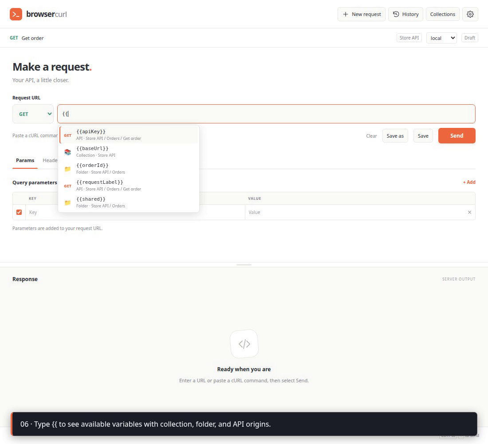
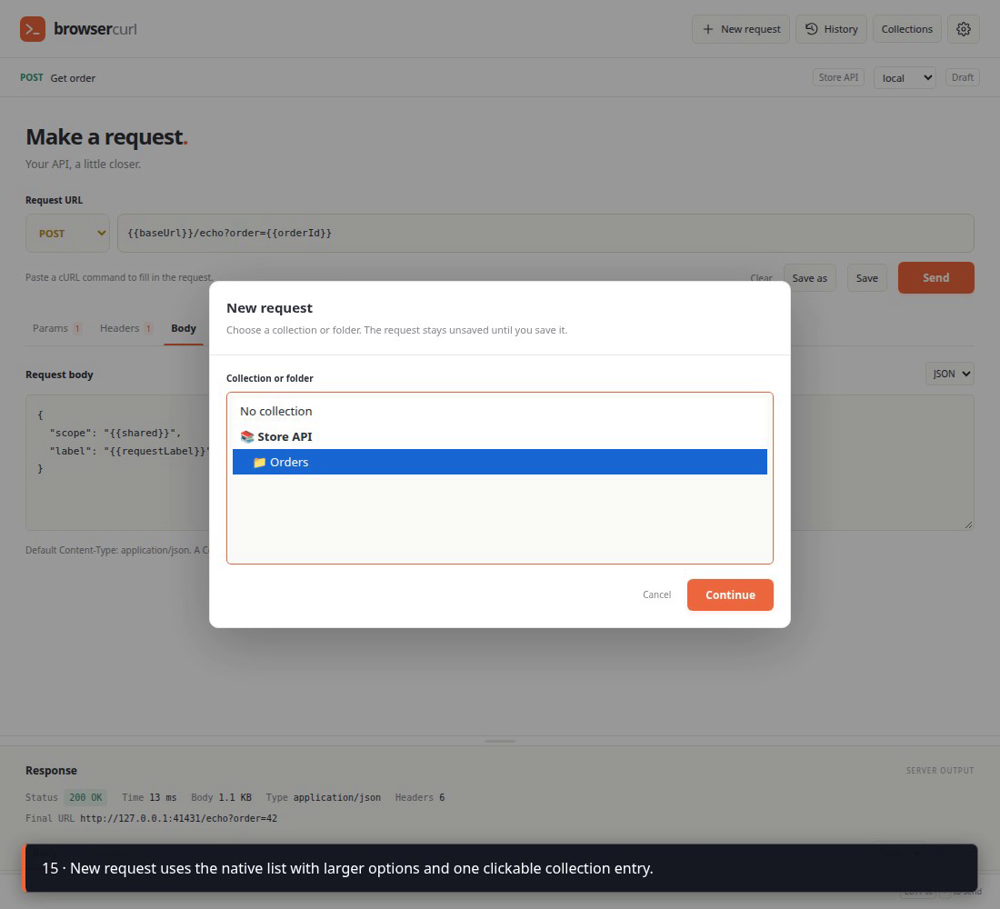
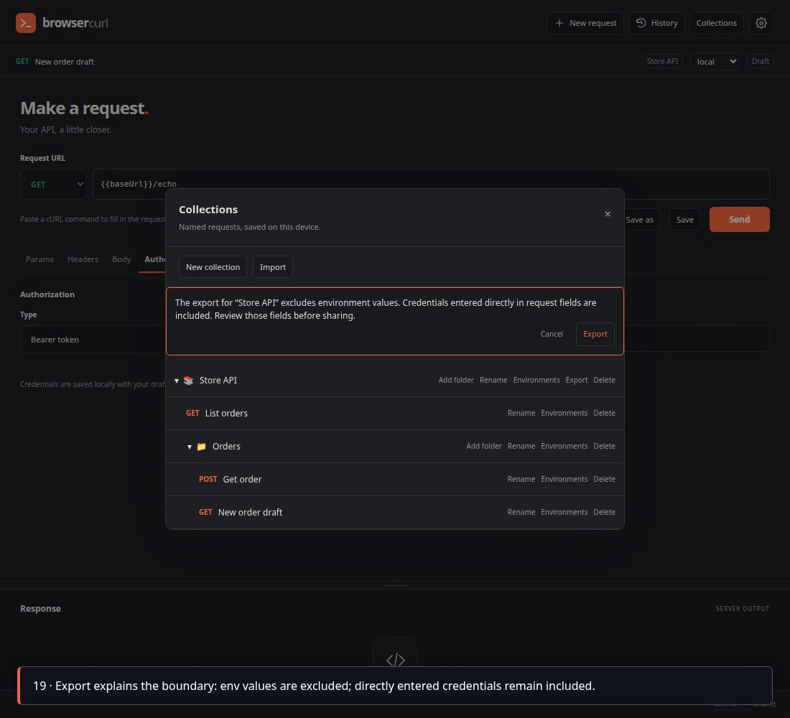

# Env suggestions and request destinations

[Play or download the full test video](env-feature-tour.webm) — **2:33**, 1100 × 1000, WebM.

This is one continuous recording of the built Chromium extension. It uses real extension storage,
a temporary local HTTP server, and actual exported downloads. All displayed credentials are test data.

## Chapters

| Time | Check |
| --- | --- |
| 00:00 | No collections: New request opens the editor directly. |
| 00:10 | Save as lists each collection once, followed by its folders. |
| 00:20 | Collection env: shared URL and credentials are kept in the local fork. |
| 00:29 | Folder env: orderId is local to Orders; shared overrides the collection. |
| 00:38 | API env: apiKey overrides its parent; requestLabel belongs to this API. |
| 00:45 | Type {{ to see available variables with collection, folder, and API origins. |
| 00:53 | Typing filters variable names. Enter inserts the complete {{orderId}} reference. |
| 01:01 | Headers support suggestions too. Arrow keys navigate; Tab inserts without submitting. |
| 01:08 | Parameter selection keeps the URL synchronized and preserves the template. |
| 01:15 | Authorization uses the nearest API variable, shown with the existing HTTP method badge. |
| 01:24 | Multiline body suggestions preserve surrounding JSON and show the effective folder source. |
| 01:31 | Real HTTP response: order=42, API credentials, folder fallback, and resolved JSON. |
| 01:38 | No env blocks unresolved variables before sending. Existing request text stays intact. |
| 01:44 | History resends the saved template using the current collection, folder, and API values. |
| 01:51 | New request uses the native list with larger options and one clickable collection entry. |
| 01:58 | A new folder request stays unsaved and inherits only its collection and folder variables. |
| 02:06 | Save remembers the chosen folder. This example also has a credential entered directly. |
| 02:13 | The same native picker works in dark mode and still offers No collection. |
| 02:20 | Export explains the boundary: env values are excluded; directly entered credentials remain included. |
| 02:26 | Passed: scoped suggestions, keyboard and mouse selection, native destinations, Save, history, and export. |

## Screenshots







## Record again

```sh
pnpm run build
FACTORY_EVIDENCE=1 pnpm exec playwright test e2e/feature-tour.spec.mjs
```

The test writes the video and chapter times to `.factory-evidence/`. Recording mode adds readable
action pacing and caption pauses. Ordinary e2e runs skip this recording-only test.

The automated walkthrough checks resolved URL parameters, headers, authorization, JSON bodies,
missing-variable blocking, history sends, unsaved destinations, Save defaults, and export contents.
Firefox and external HTTP services are outside this recording.
